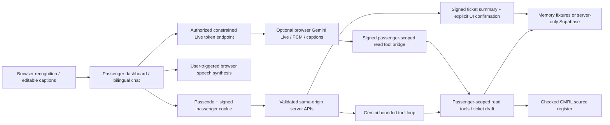

> Release checkpoint (2026-11-17): 57 tests, typecheck, optimized build and dependency audit pass. Ordinary Gemini text still fails upstream; staging has no Metro schema and remote SQL remains unexecuted at the user’s request. See [release readiness](RELEASE_READINESS.md), [Gemini reliability](GEMINI_RELIABILITY_REPORT.md), [hosted validation](SUPABASE_HOSTED_VALIDATION.md) and [browser QA](BROWSER_QA_REPORT.md) before deploying a Preview. Historical counts below describe earlier checkpoints.

# MetroSathi

Tamil and English voice + text help for Chennai Metro smart-card enquiries. **Independent hackathon prototype; not operated, endorsed or integrated with CMRL.** Every passenger, card, balance, transaction and recharge record is synthetic. Tickets stay in this prototype and are not submitted to CMRL.

## Implemented

- Responsive navy/cyan dashboard, Tamil / English / Auto, editable voice captions, text chat, quick actions and record-check indicators.
- Team passcode gate plus a separate signed, expiring HttpOnly demo passenger session. Three explicitly public synthetic profiles.
- Gemini tool loop: passenger-scoped cards, balances, transactions, recharge status, station records, fares, official guidance, ticket listing and ticket drafting.
- Browser speech recognition and speech synthesis (see [voice decision](docs/VOICE_DECISION.md)) in `ta-IN` / `en-IN`, stop controls, permission/errors, 45-second listening limit and text fallback. No automatic audio playback.
- Opt-in Gemini Live with short-lived constrained credentials, server-authorized read tools, captions and interruption/capture cleanup.
- Date-aware fare abstention, canonical station/line/stop/interchange validation, persisted language preference and speech pronunciation normalization.
- Server-signed 10-minute ticket review, explicit confirmation, ownership checks and idempotent writes.
- Process-local demo storage or explicit durable Supabase mode, additive SQL migration, source-backed fare subset and safe readiness endpoint.
- Critical unit/security and rendered DOM interaction tests, isolated PostgreSQL-compatible SQL tests and local HTTP smoke script.

**Not implemented:** production passenger authentication; real issuer/AFC/card/payment integration; full fare matrix/network/route planning; operational alerts. No payment, balance transfer, refund, actual card block or operator complaint tool exists. Native Tamil review and real-device speech testing remain required.

## Run locally

Node 22.12+ (tested with Node 24), npm and a Gemini key with model access:

```sh
npm ci
cp .env.example .env.local  # only if you do not already have .env.local
# Configure secret values locally. Do not paste them in chat.
DEMO_MODE=true METRO_STORAGE=memory npm run dev
```

Open http://localhost:3000, enter the existing team passcode, and select Kavya, Arun or Meena. Never overwrite an existing environment file. `.env.example` has variable names and explanations only. Without Gemini access the panels and support flow work, and chat gives a safe provider-unavailable response.

| Variable              | Purpose                                                                                                   |
| --------------------- | --------------------------------------------------------------------------------------------------------- |
| `APP_PASSCODE`        | Required strong team gate secret; also signs expiring gate, passenger and ticket tokens                   |
| `GEMINI_API_KEY`      | Server-only permanent API key                                                                             |
| `GEMINI_MODEL`        | Optional text model override; default `gemini-3.8-flash`, checked in Google model catalogue on 2026-11-11 |
| `DEMO_MODE`           | Must equal `true` for synthetic passenger access; otherwise fail closed                                   |
| `METRO_STORAGE`       | `memory` (default, no remote writes) or `supabase`                                                        |
| `SUPABASE_URL`        | Existing server-only Supabase project URL; required in Supabase mode                                      |
| `SUPABASE_SECRET_KEY` | Existing server-only service-role/secret key; required in Supabase mode                                   |
| `GEMINI_LIVE_ENABLED` | Optional, `true` enables the separate Live button; default disabled                                       |
| `GEMINI_LIVE_MODEL`   | Optional Live model override; default `gemini-3.8-live`                                                   |

No `NEXT_PUBLIC_*` secrets are needed. The permanent Gemini key stays on the server; only a one-use 90-second credential reaches the Live client.

## Architecture



## Database

Remote SQL has **not** been applied. Review `supabase/migrations/202611110001_metrosathi.sql`, then `seed/metrosathi.sql` and optional additive `seed/20261111_station_reference.sql`. First validate locally with `npm test`; a PGlite test executes migration, seed twice, ownership constraints, RLS grants and ticket RPC in an isolated disposable database. It does not connect to Supabase.

Use the Supabase SQL editor only after explicit approval for the exact remote action. Apply the versioned migration once, then seed. Both scripts are additive; seed conflicts preserve existing rows. The migration is one-time (trigger creation is not intended to rerun); use migration tracking. No existing table is dropped or truncated. Prefixed public tables have RLS enabled, no browser policies, and no anon/authenticated grants. The RPC is executable only by service_role. See [seed guide](seed/README.md).

Set `METRO_STORAGE=supabase` only after migration/seed. DB failures never silently switch to memory. In `memory` mode tickets are temporary per server process and may differ across Vercel instances. Official reference tools use the checked, bundled register, with the same snapshot provided in SQL; changing SQL alone does not change the app's official reference content.

## Text and voice

Chat history stays in page memory and is sent to Gemini only on submission. Tools never accept passenger identity from the browser/model. A signed draft token is sent separately to the UI and is not included in the model tool result. Only the confirmation API creates a ticket.

The Web Speech browser adapter is in `lib/voice/browser.ts`. Speech first fills the editable text field, then the user sends it. Auto answers follow the current Tamil/Tanglish/English utterance; recognition in Auto uses the most recently inferred language (English initially), so select தமிழ் explicitly for a first Tamil voice query. Installed Tamil speech voices and recognition service support vary by device/browser. Use Chrome/Edge where Web Speech is supported; text remains available everywhere. The browser speech provider may process audio remotely; this app does not persist audio/transcripts. Submitted text is processed by Gemini under Google's service terms.

Live is enabled locally with `GEMINI_LIVE_ENABLED=true DEMO_MODE=true METRO_STORAGE=memory npm run dev`. It sends microphone audio directly to Google after an explicit click; no audio is persisted by the app. A separate signed capability binds every read tool call to the current server session. The Live model cannot create ticket drafts or tickets; use the existing support confirmation flow. Browser voice/text remain available after Live failure. See [voice decision and actual evidence](docs/VOICE_DECISION.md).

## Selective open-source integration

See [integration audit](OSS_INTEGRATION_AUDIT.md), [reuse/license report](OSS_REUSE_REPORT.md) and [data provenance](DATA_PROVENANCE.md). Two MIT patterns were adapted with notices: Live event organization and locale persistence. Other upstreams informed original data/evaluation methodology; no MPL source files or unclear-license datasets were copied. No new npm dependencies.

The reference dataset covers seven named stations, Blue/Green corridor context and explicit Alandur/Central interchange memberships, not the full current network. Four directed fare pairs remain; freshness is checked per request with a local 30-day review policy. Unknown, expired, future and unsupported historical fares abstain. An offline Python importer inspects checksum-pinned GTFS, excludes fares/timetables and blocks unclear data rights. It does not promote data or write a database.

## Verification

```sh
npm run typecheck
npm test
npm run build
npm audit
```

HTTP smoke against an **isolated local test server**, with a deliberately disposable test passcode and Gemini disabled:

```sh
APP_PASSCODE=local-smoke-only DEMO_MODE=true METRO_STORAGE=memory GEMINI_API_KEY= npm start -- --hostname 127.0.0.1 --port 3210
# Separate terminal:
node scripts/smoke.mjs
```

Optional billable Live SDK/tool smoke (no microphone, no audio/transcript/credential output): start a second isolated server with `APP_PASSCODE=local-smoke-only DEMO_MODE=true METRO_STORAGE=memory GEMINI_LIVE_ENABLED=true npm start -- --hostname 127.0.0.1 --port 3211`, then run `node scripts/check-live.mjs` and `LIVE_SMOKE_LANGUAGE=ta-IN node scripts/check-live.mjs`. Preserve the configured Gemini key; never use this disposable passcode in a shared preview.

The test suite includes original paired English/Tamil evidence checks and negative controls. These are deterministic regression gates, not a claimed LLM quality percentage or human Tamil evaluation.

Do not use the smoke passcode for a shared preview. See [progress and actual results](CODEX_PROGRESS.md), [architecture](docs/ARCHITECTURE.md), [sources](docs/CMRL_DATA_SOURCES.md), [judge demo](docs/DEMO_SCRIPT.md), [security](docs/SECURITY_AND_LIMITATIONS.md), and [deployment checklist](docs/DEPLOYMENT_CHECKLIST.md).

Historical starter SQL/docs are inactive under `archive/`; never run them for MetroSathi. No deployment has been performed.
